# 07 · Modelo entidad-relación (generado)

_Generado por `python scripts/gen_docs.py` desde los modelos reales; no editar a mano._

Tablas: **37**. `PK` clave primaria, `FK` clave foránea, `UK` única. Reglas de borrado: `RESTRICT` en todo el historial educativo (nunca se borra en cascada); `CASCADE` solo en `refresh_tokens`.

```mermaid
erDiagram
  academic_periods {
    CHAR id PK
    CHAR version_id FK
    VARCHAR name
    SMALLINT sequence
    DATE start_date
    DATE end_date
  }
  academic_years {
    CHAR id PK
    CHAR school_id FK
    SMALLINT year
  }
  ai_generation_requests {
    CHAR id PK
    CHAR teacher_id FK
    CHAR assignment_id FK
    CHAR variant_id FK
    VARCHAR provider
    VARCHAR model
    VARCHAR prompt_version
    VARCHAR status
    INTEGER latency_ms
    DATETIME created_at
  }
  assignment_variants {
    CHAR id PK
    CHAR assignment_id FK
    SMALLINT grade_id FK
    SMALLINT version
    CHAR topic_id FK
    CHAR competency_id FK
    CHAR period_id FK
    TEXT learning_objective
    VARCHAR title
    TEXT instructions
    VARCHAR status
    VARCHAR source
    VARCHAR generated_by
    VARCHAR validation_status
    JSON validation_notes
    CHAR approved_by FK
    DATETIME approved_at
    DATETIME published_at
    DATETIME created_at
  }
  assignments {
    CHAR id PK
    CHAR school_id FK
    CHAR classroom_id FK
    CHAR teacher_id FK
    CHAR plan_version_id FK
    CHAR subject_id FK
    VARCHAR mode
    VARCHAR title
    TEXT base_instructions
    VARCHAR status
    DATETIME published_at
    DATETIME created_at
  }
  audit_log {
    CHAR id PK
    CHAR actor_user_id FK
    VARCHAR action
    VARCHAR target_type
    CHAR target_id
    VARCHAR request_id
    DATETIME created_at
  }
  capacities {
    CHAR id PK
    CHAR competency_id FK
    VARCHAR name
  }
  classroom_students {
    CHAR classroom_id PK
    CHAR student_user_id PK
    DATETIME joined_at
    DATETIME left_at
  }
  classroom_teachers {
    CHAR classroom_id PK
    CHAR teacher_user_id PK
  }
  classrooms {
    CHAR id PK
    CHAR school_id FK
    VARCHAR name
    SMALLINT academic_year
    DATETIME created_at
    DATETIME deleted_at
  }
  competencies {
    CHAR id PK
    CHAR subject_id FK
    VARCHAR code
    VARCHAR name
  }
  counters {
    VARCHAR name PK
    BIGINT value
  }
  curriculum_frameworks {
    CHAR id PK
    VARCHAR country_code
    VARCHAR name
    VARCHAR version_label
    BOOLEAN is_demo
    TEXT source_note
    DATETIME created_at
  }
  curriculum_plan_versions {
    CHAR id PK
    CHAR plan_id FK
    VARCHAR label
    VARCHAR status
    CHAR created_by FK
    CHAR approved_by FK
    DATETIME approved_at
    DATETIME activated_at
    DATETIME created_at
  }
  curriculum_topics {
    CHAR id PK
    CHAR unit_id FK
    CHAR competency_id FK
    CHAR capacity_id FK
    VARCHAR title
    TEXT learning_objective
    SMALLINT sequence
  }
  curriculum_units {
    CHAR id PK
    CHAR version_id FK
    CHAR period_id FK
    SMALLINT grade_id FK
    CHAR subject_id FK
    VARCHAR title
    SMALLINT sequence
  }
  domain_events {
    CHAR id PK
    VARCHAR type
    JSON payload
    VARCHAR status
    INTEGER attempts
    DATETIME next_attempt_at
    TEXT last_error
    DATETIME created_at
    DATETIME delivered_at
  }
  grades {
    INTEGER id PK
    VARCHAR level
    SMALLINT number
  }
  language_variants {
    CHAR id PK
    INTEGER language_id FK
    VARCHAR code
    VARCHAR name
    TEXT note
  }
  languages {
    INTEGER id PK
    VARCHAR code UK
    VARCHAR name
  }
  learning_attempts {
    CHAR id PK
    CHAR student_user_id FK
    CHAR student_assignment_id FK
    CHAR question_id FK
    CHAR competency_id FK
    CHAR device_id
    SMALLINT attempt_number
    JSON answer
    BOOLEAN is_correct
    BOOLEAN client_is_correct
    SMALLINT hints_used
    INTEGER response_time_ms
    DATETIME client_created_at
    DATETIME effective_at
    DATETIME received_at
  }
  questions {
    CHAR id PK
    CHAR variant_id FK
    SMALLINT position
    VARCHAR type
    TEXT prompt
    JSON options
    JSON correct_answer
    JSON hints
    TEXT explanation
    SMALLINT difficulty
  }
  refresh_tokens {
    CHAR id PK
    CHAR user_id FK
    CHAR family_id
    VARCHAR token_hash UK
    CHAR device_id
    DATETIME expires_at
    DATETIME revoked_at
    CHAR replaced_by
    DATETIME created_at
  }
  school_curriculum_plans {
    CHAR id PK
    CHAR school_id FK
    CHAR academic_year_id FK
    CHAR framework_id FK
    VARCHAR name
    DATETIME created_at
  }
  schools {
    CHAR id PK
    VARCHAR name
    VARCHAR code UK
    CHAR ugel_unit_id FK
    VARCHAR region
    DATETIME created_at
    DATETIME updated_at
    DATETIME deleted_at
  }
  student_assignments {
    CHAR id PK
    CHAR assignment_id FK
    CHAR variant_id FK
    CHAR student_user_id FK
    BIGINT seq
    VARCHAR status
    VARCHAR origin
    DATETIME created_at
  }
  student_competency_progress {
    CHAR id PK
    CHAR student_user_id FK
    CHAR competency_id FK
    NUMERIC score
    INTEGER evidence_count
    VARCHAR state
    VARCHAR method_version
    DATETIME computed_at
  }
  student_languages {
    CHAR student_user_id PK
    INTEGER mother_language_id FK
    CHAR mother_variant_id FK
    INTEGER preferred_language_id FK
    DATETIME updated_at
  }
  student_profiles {
    CHAR user_id PK
    CHAR school_id FK
    SMALLINT grade_id FK
  }
  subjects {
    CHAR id PK
    CHAR framework_id FK
    VARCHAR name
  }
  support_flags {
    CHAR id PK
    CHAR student_user_id FK
    CHAR competency_id FK
    VARCHAR rule_id
    VARCHAR rule_version
    VARCHAR status
    JSON evidence
    VARCHAR recommendation_code
    DATETIME created_at
    DATETIME updated_at
    DATETIME resolved_at
  }
  sync_events {
    CHAR id PK
    CHAR event_id UK
    CHAR device_id
    CHAR student_user_id FK
    VARCHAR type
    VARCHAR status
    VARCHAR reason
    DATETIME received_at
  }
  teacher_interventions {
    CHAR id PK
    CHAR teacher_id FK
    CHAR student_user_id FK
    CHAR competency_id FK
    CHAR support_flag_id FK
    VARCHAR strategy
    TEXT notes
    NUMERIC score_at_creation
    DATETIME created_at
  }
  teacher_profiles {
    CHAR user_id PK
    CHAR school_id FK
  }
  ugel_units {
    CHAR id PK
    VARCHAR name
    VARCHAR region
    VARCHAR code UK
  }
  users {
    CHAR id PK
    VARCHAR email UK
    VARCHAR login_code UK
    VARCHAR password_hash
    VARCHAR role
    VARCHAR display_name
    BOOLEAN is_active
    INTEGER failed_login_count
    DATETIME locked_until
    DATETIME created_at
    DATETIME updated_at
    DATETIME deleted_at
  }
  variant_translations {
    CHAR id PK
    CHAR variant_id FK
    INTEGER language_id FK
    CHAR language_variant_id FK
    VARCHAR title
    TEXT instructions
    JSON question_prompts
    VARCHAR status
    CHAR created_by FK
    CHAR verified_by FK
    DATETIME verified_at
  }
  academic_periods ||--o{ assignment_variants : "period_id"
  academic_periods ||--o{ curriculum_units : "period_id"
  academic_years ||--o{ school_curriculum_plans : "academic_year_id"
  assignment_variants ||--o{ ai_generation_requests : "variant_id"
  assignment_variants ||--o{ questions : "variant_id"
  assignment_variants ||--o{ student_assignments : "variant_id"
  assignment_variants ||--o{ variant_translations : "variant_id"
  assignments ||--o{ ai_generation_requests : "assignment_id"
  assignments ||--o{ assignment_variants : "assignment_id"
  assignments ||--o{ student_assignments : "assignment_id"
  capacities ||--o{ curriculum_topics : "capacity_id (opcional)"
  classrooms ||--o{ assignments : "classroom_id"
  classrooms ||--o{ classroom_students : "classroom_id"
  classrooms ||--o{ classroom_teachers : "classroom_id"
  competencies ||--o{ assignment_variants : "competency_id"
  competencies ||--o{ capacities : "competency_id"
  competencies ||--o{ curriculum_topics : "competency_id"
  competencies ||--o{ learning_attempts : "competency_id"
  competencies ||--o{ student_competency_progress : "competency_id"
  competencies ||--o{ support_flags : "competency_id"
  competencies ||--o{ teacher_interventions : "competency_id"
  curriculum_frameworks ||--o{ school_curriculum_plans : "framework_id"
  curriculum_frameworks ||--o{ subjects : "framework_id"
  curriculum_plan_versions ||--o{ academic_periods : "version_id"
  curriculum_plan_versions ||--o{ assignments : "plan_version_id"
  curriculum_plan_versions ||--o{ curriculum_units : "version_id"
  curriculum_topics ||--o{ assignment_variants : "topic_id"
  curriculum_units ||--o{ curriculum_topics : "unit_id"
  grades ||--o{ assignment_variants : "grade_id"
  grades ||--o{ curriculum_units : "grade_id"
  grades ||--o{ student_profiles : "grade_id"
  language_variants ||--o{ student_languages : "mother_variant_id (opcional)"
  language_variants ||--o{ variant_translations : "language_variant_id (opcional)"
  languages ||--o{ language_variants : "language_id"
  languages ||--o{ student_languages : "mother_language_id (opcional)"
  languages ||--o{ student_languages : "preferred_language_id (opcional)"
  languages ||--o{ variant_translations : "language_id"
  questions ||--o{ learning_attempts : "question_id"
  school_curriculum_plans ||--o{ curriculum_plan_versions : "plan_id"
  schools ||--o{ academic_years : "school_id"
  schools ||--o{ assignments : "school_id"
  schools ||--o{ classrooms : "school_id"
  schools ||--o{ school_curriculum_plans : "school_id"
  schools ||--o{ student_profiles : "school_id"
  schools ||--o{ teacher_profiles : "school_id"
  student_assignments ||--o{ learning_attempts : "student_assignment_id"
  subjects ||--o{ assignments : "subject_id"
  subjects ||--o{ competencies : "subject_id"
  subjects ||--o{ curriculum_units : "subject_id"
  support_flags ||--o{ teacher_interventions : "support_flag_id (opcional)"
  ugel_units ||--o{ schools : "ugel_unit_id (opcional)"
  users ||--o{ ai_generation_requests : "teacher_id"
  users ||--o{ assignment_variants : "approved_by (opcional)"
  users ||--o{ assignments : "teacher_id"
  users ||--o{ audit_log : "actor_user_id"
  users ||--o{ classroom_students : "student_user_id"
  users ||--o{ classroom_teachers : "teacher_user_id"
  users ||--o{ curriculum_plan_versions : "approved_by (opcional)"
  users ||--o{ curriculum_plan_versions : "created_by"
  users ||--o{ learning_attempts : "student_user_id"
  users ||--o{ refresh_tokens : "user_id"
  users ||--o{ student_assignments : "student_user_id"
  users ||--o{ student_competency_progress : "student_user_id"
  users ||--o{ student_languages : "student_user_id"
  users ||--o{ student_profiles : "user_id"
  users ||--o{ support_flags : "student_user_id"
  users ||--o{ sync_events : "student_user_id"
  users ||--o{ teacher_interventions : "student_user_id"
  users ||--o{ teacher_interventions : "teacher_id"
  users ||--o{ teacher_profiles : "user_id"
  users ||--o{ variant_translations : "created_by"
  users ||--o{ variant_translations : "verified_by (opcional)"
```

## Restricciones relevantes (CHECK / índices parciales / triggers)
- **academic_periods**: `ck_period_dates`
- **academic_years**: `ck_academic_year`
- **assignment_variants**: `ck_variant_human_approval`; `ck_variant_ai_provenance`; `ck_variant_status`; `ck_variant_validation`; `ck_variant_source`
- **assignments**: `ck_assignment_status`; `ck_assignment_mode`
- **classrooms**: `ck_classroom_year`
- **curriculum_plan_versions**: `ck_plan_version_status`; `ck_plan_version_approver`; índice único parcial `uq_one_active_version_per_plan`
- **domain_events**: `ck_event_status`
- **grades**: `ck_grades_level`; `ck_grades_number`
- **learning_attempts**: `ck_attempt_hints`; `ck_attempt_time`; `ck_attempt_number`
- **questions**: `ck_question_type`; `ck_question_difficulty`
- **student_assignments**: `ck_student_assignment_status`; `ck_student_assignment_origin`
- **support_flags**: `ck_flag_status`; índice único parcial `uq_active_flag`
- **sync_events**: `ck_sync_event_status`
- **users**: `ck_users_identity`; `ck_users_role`
- **variant_translations**: `ck_translation_status`; `ck_translation_verified_by`
- **learning_attempts**: triggers `trg_learning_attempts_no_update` / `_no_delete` (append-only, definidos en la migración).
